# hctui

A lightweight terminal system monitor for Linux, WSL and Raspberry Pi. Eight
pages share cached measurements and adapt to narrow terminals. No desktop or
GPU is required. Dashboard definitions use YAML; the interface uses Urwid.

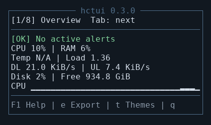

## Installation

Requires Python 3.9 or later. Run these commands in the repository directory:

```bash
python3 -m venv .venv
source .venv/bin/activate
python -m pip install .
hctui
```

On Windows, use a WSL terminal and install into a Linux virtual environment.
In VS Code, connect with **WSL: Connect to WSL** and open the Linux checkout.
WSL reports measurements for its Linux environment, rather than the entire
Windows host. For faster installation and file access, keep the checkout in
the Linux filesystem when practical.

On Raspberry Pi Zero, start with:

```bash
hctui --refresh-ms 2000 --history-size 30
```

Install only runtime dependencies on the device. If `psutil` needs to compile,
install the OS Python development headers and a C compiler. PyYAML works with
its Python loader when the optional C loader is unavailable. Performance on a
physical Pi Zero has not been measured; the figures below are from a PC in WSL.

For development, install with `python -m pip install -e '.[dev]'`. You can also
run `python -m hctui` or `python src/hctui.py` with dependencies installed.

## Controls

| Key | Action |
| --- | --- |
| `F1` | Open help with controls, pages and measurement explanations |
| `F10` | Show `jotbek` and `made this!` |
| `t` | Open the color theme selector |
| `e` | Export every metric source to a standalone HTML snapshot |
| `Tab` / Right | Next page |
| Shift+Tab / Left | Previous page |
| `1`–`8` | Select a page directly |
| Up / Down, Page Up / Page Down | Scroll the current page or dialog |
| `+` / `-` | Increase/decrease UI refresh interval by 100 ms; minimum 100 ms |
| `r` | Reload and validate YAML definitions |
| Esc / Enter | Close help, credits or report dialog |
| `q` | Quit, including from a dialog |

In the theme selector, use Up/Down and Enter to apply a theme, or Esc to cancel.
The dashboard continues refreshing behind dialogs. Repeating F1, F10 or `t`
closes that dialog. Failed reloads retain the working dashboard and show an error.

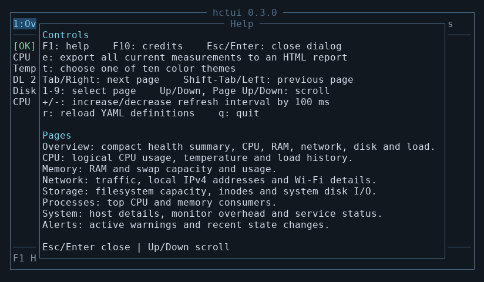

## Pages and measurements

The overview fits a **40×12** terminal. Other pages scroll; tables hide secondary
columns on narrow screens, and wide side-by-side panels stack vertically.
The interface is also checked at 32×10, where more scrolling is needed.

| Page | Contents |
| --- | --- |
| 1 Overview | Health summary, CPU/RAM, temperature/load, traffic, disk/free space, CPU history |
| 2 CPU | Total usage, logical CPU table, frequency/core counts, temperature and load history |
| 3 Memory | RAM and swap capacity, available memory and usage bars |
| 4 Network | Download/upload rates and history, local IPv4 addresses, Wi-Fi information |
| 5 Storage | Selected filesystem capacity, system disk I/O, local filesystem and inode usage |
| 6 Processes | Five highest CPU consumers and five highest memory consumers |
| 7 System | Host, uptime, OS/kernel/model, hctui overhead, services and available sensors |
| 8 Alerts | Active warnings and the most recent 20 state transitions |

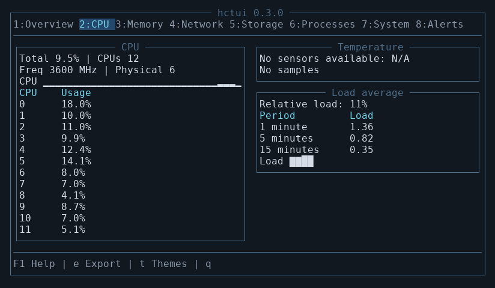
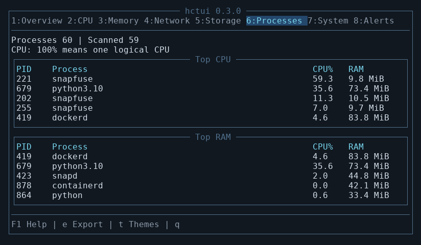
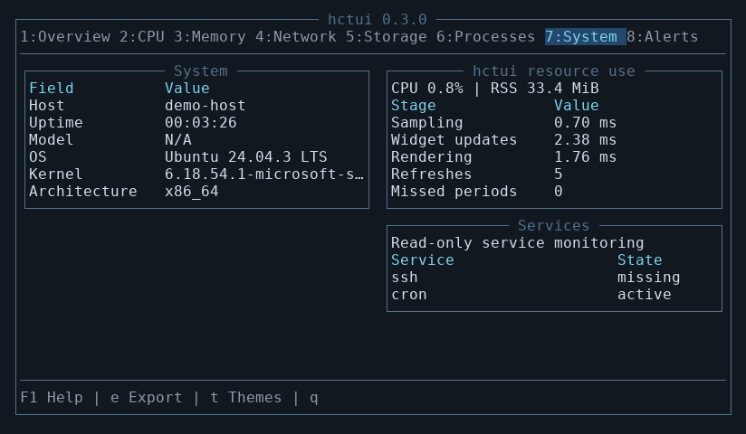

Other screenshots: [memory](docs/screenshots/memory.png),
[network](docs/screenshots/network.png), [storage](docs/screenshots/storage.png),
[alerts](docs/screenshots/alerts.png), [small processes](docs/screenshots/processes-small.png),
[wide CPU](docs/screenshots/cpu-wide.png), [credits](docs/screenshots/credits.png).
These images capture real Urwid canvases and live WSL measurements; host names,
local IPv4 addresses and Wi-Fi SSIDs are redacted for documentation.

CPU usage describes logical CPUs. The first CPU/network/disk-rate sample
establishes a baseline and shows zero. A process using one logical CPU reports
100%; multithreaded processes may exceed 100%. RAM used is total minus available.
Rates use actual monotonic elapsed time. Network traffic follows the default IPv4
interface, falling back to all interfaces; switching interfaces resets history.
Disk capacity follows `--disk-path`, while disk I/O covers **all system disks**.
Histories retain samples rather than a fixed duration.

Temperature and hardware details depend on available sensors. Wi-Fi uses Linux
wireless information; installing `iw` enables additional SSID and dBm details.
Raw wireless quality is not treated as a percentage. Services use a batched,
read-only `systemctl show` call and require a working systemd environment.
No privileged commands or service changes are performed. Unsupported probes
display N/A or an explanation, rather than invented values.

Alerts warn at 90% CPU/RAM/disk usage and become critical at 98%. CPU must remain
high for ten seconds. Temperature defaults to warning at 80°C and critical at
85°C; change the warning level with `--temperature-warning`. Five-point
hysteresis reduces flicker. Failed services raise critical alerts; missing units
are listed separately. Lost readings after an alert become UNKNOWN. The tab bar
shows the number of active conditions. Health sampling stays active across pages.

## Ten color themes

Press `t` to choose **Midnight, Nord, Dracula, Solarized Dark, Solarized Light,
Gruvbox, Monokai, Tokyo Night, Catppuccin or High Contrast**. Borders, headings,
selected tabs, backgrounds and progress bars change together. Health badges
also retain text labels, so their meaning does not depend on color alone.

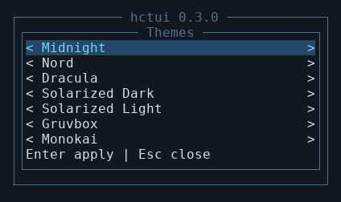

| Midnight | Nord |
| --- | --- |
|  | 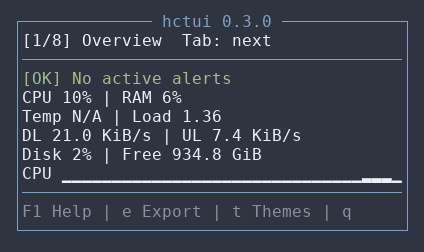 |
| Dracula | Solarized Light |
| 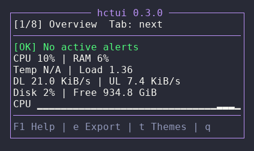 | 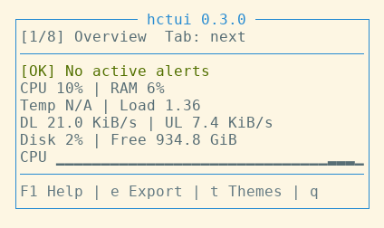 |
| Gruvbox | Tokyo Night |
| 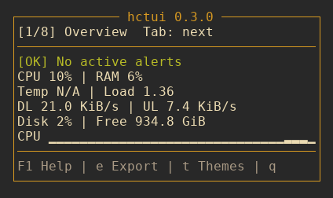 | 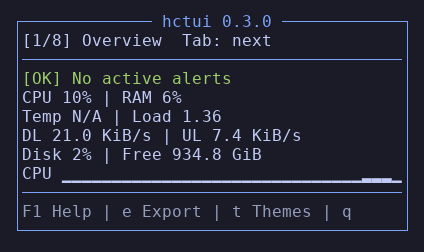 |

Remaining previews: [Solarized Dark](docs/screenshots/theme-solarized-dark.png),
[Monokai](docs/screenshots/theme-monokai.png), [Catppuccin](docs/screenshots/theme-catppuccin.png),
[High Contrast](docs/screenshots/theme-high-contrast.png).

Theme choice applies to the current session. Set the startup theme explicitly:

```bash
hctui --theme 'Solarized Light'
```

Use a terminal supporting 256 colors and a monospace font with Unicode box
drawing characters. Palettes also include basic color fallbacks.

## Export a complete snapshot

Press `e` to briefly collect **all 13 sources**, including those on hidden pages.
The monitor remains responsive while slower probes and the file write run in
the background. A completion dialog shows the full report path. By default,
reports go into `reports/` under the current working directory:

```bash
hctui --report-dir ~/hctui-reports
```

Open the resulting `hctui-<UTC timestamp>-<unique suffix>.html` in a browser.
The report contains CPU, memory, network, disk, load, sensors, system details,
process lists, filesystems, services, Wi-Fi, monitor overhead and alerts,
including retained histories and events. It includes the capture time, units,
per-source sample age/cadence, probe errors and an expandable complete JSON
snapshot. It has no external assets or dependencies.

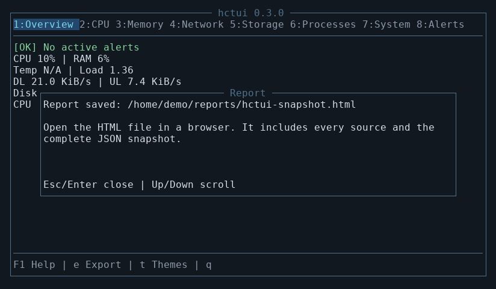

The snapshot combines readings taken at independent cadences, rather than
pretending that all probes ran simultaneously. If collection has not completed
after ten seconds, the latest available values are saved and unfinished probes
are marked. Repeated `e` presses while exporting do not start duplicate jobs.
If process monitoring has just started, export waits for its second sample
to establish CPU rates; this normally takes about five seconds.
Report files contain actual host and network details; check them before sharing.
Exported files are excluded from Git.

## Configuration examples

```bash
hctui --check
hctui --widget examples/compact.yaml
hctui --widget examples/pages.yaml --theme Nord
hctui --refresh-ms 2000 --history-size 30 --disk-path /home
hctui --service ssh --service nginx --temperature-warning 75
```

`--service` can be repeated and replaces the default ssh/cron list. `--check`
validates all includes and renders every page at 40×12 and 80×24 without opening
the UI; optional background probes may still be warming up. See `hctui --help`
for all options.

The included [compact example](examples/compact.yaml) is a small CPU/RAM dashboard;
the [paged example](examples/pages.yaml) demonstrates tables, history, adaptive
layouts and conditional sensor panels. Edit YAML and press `r` to reload.
See the [widget definition reference](docs/widget_definitions.md) for every
source, property, limit and migration instruction. The VS Code YAML extension
uses the schema modeline for validation and completion.

## Resource use and development

Definitions are read/validated at startup or explicit reload, never on a normal
refresh. Compiled expressions, page widgets and scroll positions are retained.
Unchanged snapshot identities skip expression evaluation; unchanged properties
skip UI setters. Only active-page sources and health dependencies are sampled.
Providers retain bounded state when paused, so revisiting a page reuses them.

Default source cadences range from one second for CPU/network to thirty seconds
for host metadata. A single lazy worker handles slow probes; exports temporarily
use a second worker to write the report. Each source has at most one pending job.
Commands have timeouts, histories are bounded to 600 samples, process scans to
4,096 PIDs, filesystem lists to 16 paths, and alert events to 20 transitions.
Idle workers sleep on their queues without periodic polling; the export worker
exits after completing a report.
There are no continuous definition-file polls or persistent logs. UI scheduling
skips missed periods rather than accumulating overdue refreshes.

Measured on a PC in WSL 2 with Python 3.12, Urwid 4.2.5, psutil 7.2.2 and
PyYAML 6.0.3, using 500 Overview refreshes at 80×24 with the final UI:
cached refresh median **1.33 ms**, p95 **3.56 ms**; forced foreground sampling
median **3.59 ms**, p95 **9.37 ms**. RSS was approximately **33–34 MiB**, with
about 10–11 KiB of additional retained traced allocations. Tests and package
building ran concurrently, so these figures also include host-load variation.
These stress runs exclude terminal output and do not establish Pi performance
or prove absence of long-running leaks. Re-run on the target device:

```bash
python -m pytest -q
ruff check src tests scripts
ruff format --check src tests scripts
python scripts/generate_widget_schema.py --check
python scripts/benchmark.py --iterations 500
python scripts/benchmark.py --iterations 500 --force
python scripts/capture_screenshots.py
python -m build
```

Runtime code is in `src/hctui/`: `app.py` handles input/scheduling,
`metrics.py` and `system_metrics.py` collect snapshots, `sampling.py` runs bounded
background probes, `health.py` derives alerts/overhead, `reports.py` exports,
`themes.json` contains the palettes, `views/` renders the interface, and
`widget_composer.py` validates and binds definitions from `widgets/`.
